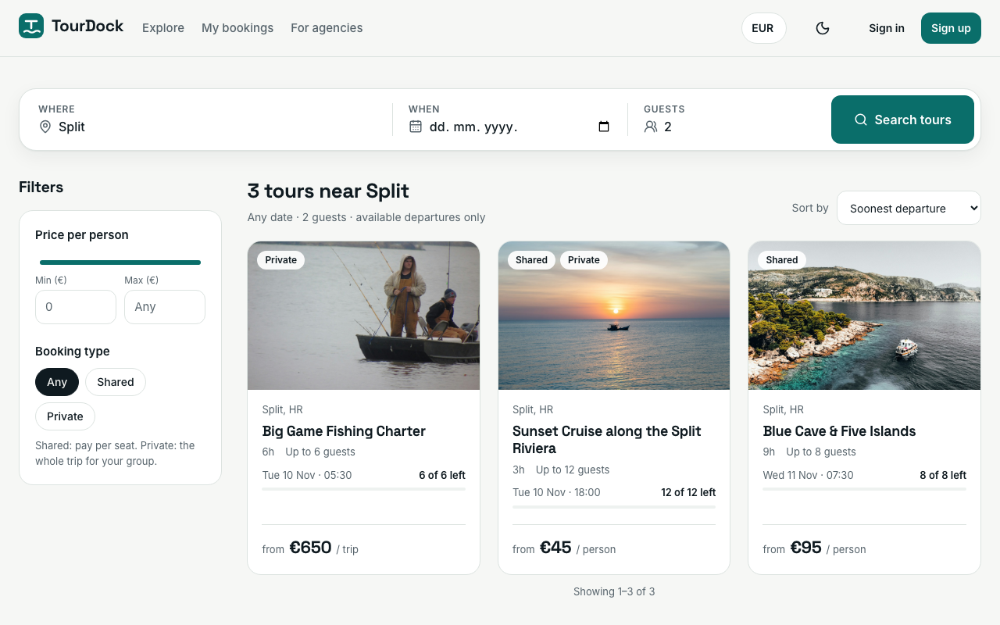
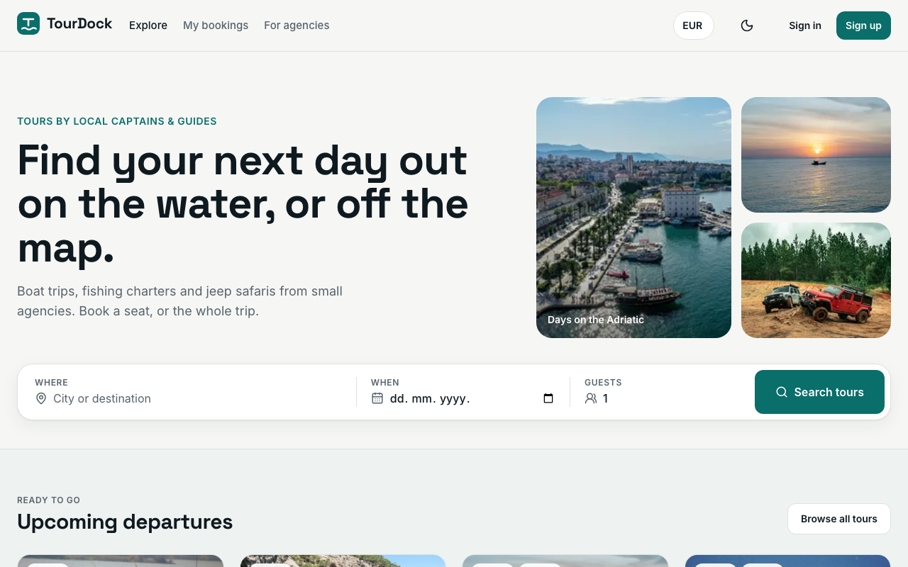
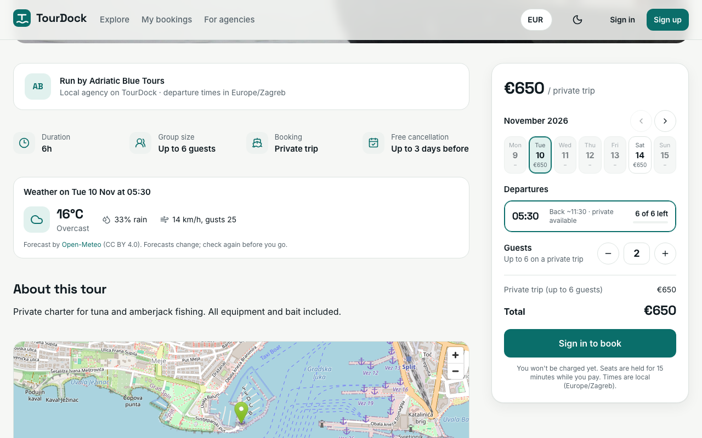
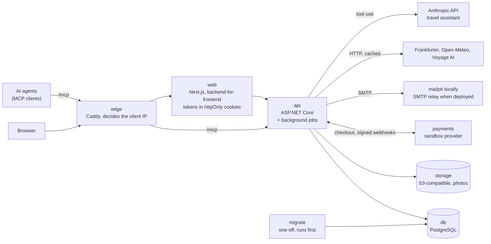
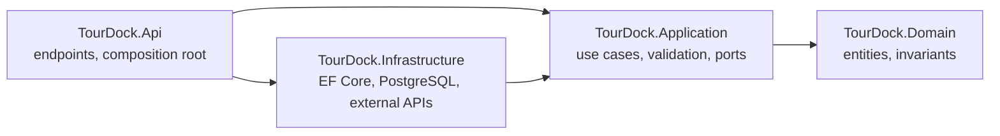

# TourDock

A marketplace backend where **operators** (boat captains, guides) publish **tours** (fishing trips, boat tours,
guided excursions) and **customers** search for and book them.

It's a .NET 10 API with a Next.js web app, and everything runs in Docker Compose. It was built in segments, and every architectural
decision is recorded as an [ADR](docs/adr).

**Live demo: [tourdock.stefanristic.com](https://tourdock.stefanristic.com)**. It has the fictional demo catalog, semantic search, the travel assistant, sign-in with Google, and [MCP for AI apps](https://tourdock.stefanristic.com/ai). Payments run in a sandbox, so no real money moves.



<details>
<summary>More screenshots</summary>




</details>

## Core flows
- Agencies (operators) register, get approved by an admin, and manage tours, vehicles, departures, seasonal prices and refund tiers.
- Customers search tours by location, date, group size and price, and can describe the trip in their own words to get the best matches first.
- A travel assistant (Claude) answers questions about tours from live data, citing the tours it recommends.
- An MCP server lets any AI assistant (Claude, ChatGPT, IDE agents) search tours, read details and check departures, and, once the user connects their account with OAuth, hold seats, list and cancel bookings, or work for their agency.
- Customers book seats or a whole departure: pending → confirmed → completed / cancelled, with policy-based refunds and partial cancellation.
- A sandbox payment provider (idempotent requests, signed webhooks) and email notifications through a transactional outbox.
- Reviews for completed trips only, with agency replies, reports and admin moderation.
- External data: currency exchange rates and weather forecasts, with timeouts, retries, circuit breaking and graceful degradation.

## Interesting problems
| Problem | How it's handled | ADR |
|---|---|---|
| Two customers book the last seat at the same time | A short transaction locks the departure row (`SELECT ... FOR UPDATE`); a test runs parallel bookings against real PostgreSQL | [0010](docs/adr/0010-booking-flow-and-concurrency.md) |
| Double clicks and retried requests | `Idempotency-Key` on bookings, idempotent payment starts and webhook handling | [0010](docs/adr/0010-booking-flow-and-concurrency.md), [0011](docs/adr/0011-payments-webhooks-outbox.md) |
| Money and time zones | `decimal` money with currency, instants in UTC, schedules in the tour's local time (IANA zone), stable across DST | [0006](docs/adr/0006-domain-model.md) |
| Side effects that must not get lost | Domain events become outbox rows in the same transaction; a worker retries with backoff and parks failures | [0011](docs/adr/0011-payments-webhooks-outbox.md), [0018](docs/adr/0018-notifications-and-background-jobs.md) |
| One agency must never see another's data | Access checks plus agency-scoped queries: another agency's tour is simply "not found" | [0008](docs/adr/0008-tenancy-and-availability.md) |
| Flaky third-party APIs | Timeouts, retries, circuit breaker and cache; the page still works when they're down | [0017](docs/adr/0017-external-apis-exchange-rates-weather.md) |
| Fake or abusive reviews | Only completed trips, time windows, reports without auto-hide, audited moderation | [0019](docs/adr/0019-reviews-and-moderation.md) |
| Abuse and leaking personal data | Rate limits, security headers, trace ids in every error, a test that no email or token reaches the logs | [0020](docs/adr/0020-observability-and-hardening.md) |
| Fake sign-ups and mistyped addresses | Booking needs a confirmed email; hashed single-use links sent through the outbox | [0021](docs/adr/0021-email-confirmation-and-branded-emails.md) |
| "Tours near Split", not "city starts with Split" | Seeded places with accent-free autocomplete; radius search with earthdistance and a GiST index | [0022](docs/adr/0022-places-and-radius-search.md) |
| Sign-up form revealing who has an account | Email-first sign-up: always "check your inbox"; sign-in needs the confirmed address | [0023](docs/adr/0023-email-first-sign-up.md) |
| "A calm boat trip for kids" when descriptions say "a gentle cruise" | Embeddings (Voyage AI) in PostgreSQL with pgvector; filters decide the matches, meaning decides the order; a job re-embeds changed tours; search falls back to its normal order if the provider is down | [0025](docs/adr/0025-semantic-search.md) |
| An AI assistant that must not invent tours, prices or dates | Read-only tools over the public query handlers, results as citable search results, cited tours returned with the answer; turn, daily and per-client limits; an eval of 30 questions | [0026](docs/adr/0026-travel-assistant.md) |
| Letting other people's AI agents use TourDock | An MCP server inside the API with the assistant's own read-only tools (defined once), stateless, rate-limited, routed by the edge | [0027](docs/adr/0027-mcp-server.md) |
| An AI agent acting for a user without ever seeing their password | OAuth 2.1 (OpenIddict) with PKCE, resource-bound tokens, scopes, dynamic client registration and consent in the web app; agents only hold seats and cancel after a confirmed preview | [0028](docs/adr/0028-oauth-for-mcp.md) |
| Signing in without a password | "Continue with Google": authorization code + PKCE through the web app, the code redeemed and the ID token checked by the API; verified emails link existing accounts, an unconfirmed account loses its password when linked | [0029](docs/adr/0029-sign-in-with-google.md) |
| Faked client IPs dodging rate limits, and strangers locking accounts | An edge proxy decides the client IP; failed sign-ins throttle the guessing address per email, not the account | [0024](docs/adr/0024-edge-proxy-and-client-ip.md) |
| A refund the provider declines | Retried under a new idempotency key, then shown to admins with an audited retry; readiness turns Degraded | [0011](docs/adr/0011-payments-webhooks-outbox.md) |

## Run it

The only requirements are **Docker** and **Git**.

```bash
cp .env.example .env    # optional: compose has local-only defaults
docker compose up --build
```

| Endpoint | Purpose |
|---|---|
| `http://localhost:3000` | Web app (Next.js) |
| `http://localhost:8080/health/live` | Liveness: the process is up |
| `http://localhost:8080/health/ready` | Readiness: the database is reachable (reports `Degraded` when the outbox is stuck) |
| `http://localhost:8025` | Mailpit: every email the app sends (nothing leaves your machine) |

On startup, a one-off `migrate` container applies database migrations (an EF Core migrations bundle), and the API only starts after it succeeds.
The database is filled with a **fictional demo catalog**: 15 invented agencies and 38 tours at real places in 12 countries, from the Serbian mountains and the Adriatic to Santorini, the Algarve and the Norwegian fjords. Every tour has real photos, seasonal schedules and prices, and a refund policy (set `SEED_DEMO_DATA=false` to skip). The seeder brings the demo agencies back to this catalog on every start: it updates what changed, retires dropped tours with a soft delete, and uploads photos in the background through the normal photo pipeline. Try search right away:

```bash
curl "localhost:8080/api/v1/tours?city=lagos&radiusKm=50&guests=2&sort=PriceAsc"
```

**Semantic search** (optional) needs a [Voyage AI](https://www.voyageai.com) key; the free tier is plenty. Store it in
`.env` without echoing it with `scripts/set-env-key.sh VOYAGE_API_KEY`. Within a minute of startup the API embeds the demo
tours, and a description orders the results by meaning:

```bash
curl "localhost:8080/api/v1/tours?q=calm%20boat%20trip%20for%20a%20family&guests=4"
```

Without a key, `q` is accepted and the response says `"semantic": false`.

**Travel assistant** (optional) needs an Anthropic API key: `scripts/set-env-key.sh ANTHROPIC_API_KEY`. Use one with
a spending limit; the API also caps messages per client, per conversation and per day. The web then shows an
"Ask TourDock" button on the browsing pages:

```bash
curl -s localhost:8080/api/v1/assistant/messages -H 'Content-Type: application/json' \
  -d '{"message":"A calm boat trip for a family with small kids near Split?"}'
```

**MCP server**: AI agents connect to `http://localhost:3000/mcp` (Streamable HTTP, no sign-in; through the edge, like
the web app). Try it with the MCP Inspector (`npx @modelcontextprotocol/inspector`, transport "Streamable HTTP"), or add
it to Claude Code:

```bash
claude mcp add --transport http tourdock http://localhost:3000/mcp
```

Then ask "find me a sunset boat trip near Split for two". The tools are `search_tours`, `get_tour` and `get_departures`,
all read-only ([ADR 0027](docs/adr/0027-mcp-server.md)).

For personal tools, connect `http://localhost:3000/mcp/account` instead. The client registers itself, opens TourDock's
consent page (sign in, then "Allow"), and gets a token for the scopes you allowed: `bookings` (list, hold seats with a
checkout link, cancel after a confirmed preview), `agency:read` and `agency:write`
([ADR 0028](docs/adr/0028-oauth-for-mcp.md)):

```bash
claude mcp add --transport http tourdock-account http://localhost:3000/mcp/account
```

Travelers find both addresses, with steps for Claude, ChatGPT, Claude Code, VS Code and Cursor, on the **Use with AI**
page (`/ai`, linked from the footer and the chat). It shows the deployment's own addresses (`PUBLIC_ORIGIN` when set).

Payments go to a **sandbox provider** container. Paying a booking returns a checkout URL like
`http://localhost:8090/checkout/pay_...`, a provider-style checkout in test mode. Pay with a saved demo card (Visa
•••• 0002 always declines) or add a test card: `4242 4242 4242 4242` is approved, `4000 0000 0000 0002` declined,
`4000 0000 0000 9995` has insufficient funds. After paying, a short 3-D Secure style step ("Confirming with your
bank…", then approved or declined, no code to type) sends the traveler back to TourDock on its own. The sandbox
notifies the API with a signed webhook. Never enter a real card number.
No real money is involved.

Booking emails (confirmed, cancelled, guests reduced, refund sent) go through the outbox to **Mailpit**: open
`http://localhost:8025` to read them. The deployment (`deploy/`) sends real email through an SMTP relay instead
([ADR 0018](docs/adr/0018-notifications-and-background-jobs.md)).

## Develop

Open the folder in VS Code and choose **"Reopen in Container"** (Dev Containers extension).
The container includes the .NET 10 SDK, C# Dev Kit, debugger and PostgreSQL. It also enables the gitleaks pre-commit hook.

```bash
dotnet watch --project src/TourDock.Api   # hot reload on http://localhost:8080
dotnet test --solution TourDock.slnx     # all tests (integration tests start PostgreSQL via Testcontainers)
dotnet ef migrations add <Name> --project src/TourDock.Infrastructure --output-dir Persistence/Migrations
dotnet ef database update --project src/TourDock.Infrastructure
```

### Tests

| Suite | Tests | What it covers |
|---|---|---|
| `TourDock.Domain.UnitTests` | 63 | Invariants of tours, departures, bookings, reviews, refunds; money; schedules across DST |
| `TourDock.Application.UnitTests` | 58 | Email notifications, exchange-rate and weather clients with mocked HTTP |
| `TourDock.ArchitectureTests` | 8 | Layer dependencies, placement (endpoints never touch the database), size limits |
| `TourDock.PaymentSandbox.Tests` | 17 | The sandbox provider: idempotency, test cards, signed webhooks |
| `TourDock.Api.IntegrationTests` | 153 | Real HTTP against real PostgreSQL (Testcontainers): booking races, tenancy matrix, explicit auth on every endpoint, payments and refund retries, outbox, rate limits, logs |
| `web` (Vitest) | 163 | Components, auth cookies and token refresh, the backend-for-frontend proxy, CSP |

Line coverage (on demand, no minimum): about 81% of the backend, from
`dotnet test --solution TourDock.slnx -- --coverage --coverage-output-format cobertura`.

CI runs all of them on every release, plus formatting and gitleaks. Semgrep and the vulnerable-package check run nightly (`security-scan.yml`). The Compose smoke test and the Playwright e2e suite run locally during development, not in CI (see `web/e2e/README.md`).

Without the Dev Container, tests can run in a throwaway SDK container:

```bash
docker run --rm -v "$PWD":/src -w /src -v /var/run/docker.sock:/var/run/docker.sock \
  -e TESTCONTAINERS_HOST_OVERRIDE=host.docker.internal \
  mcr.microsoft.com/dotnet/sdk:10.0.404 dotnet test --solution TourDock.slnx
```

## Web frontend

The web app in [`web/`](web) is Next.js (App Router) with TypeScript, Tailwind CSS v4 and shadcn/ui.
It acts as a **backend-for-frontend**: it signs users in through the API and keeps the tokens in `httpOnly` cookies,
so browser JavaScript never sees them ([ADR 0012](docs/adr/0012-frontend-nextjs.md)).
`docker compose up --build` starts it on **http://localhost:3000** (change the port with `WEB_PORT`).
The image builds the standalone server and its matching static assets together; use that rebuild command after
frontend changes instead of copying `.next` files into a running container.

The host doesn't need Node.js. Run the checks in a throwaway container:

```bash
docker run --rm -v "$PWD/web":/app -w /app node:26.13.0-alpine3.24 \
  sh -c "npm ci && npm run lint && npm run typecheck && npm test && npm run build"
```

The API types are generated from the OpenAPI document, which the API serves in Development:

```bash
ASPNETCORE_ENVIRONMENT=Development docker compose up --build -d
curl -s localhost:8080/openapi/v1.json -o web/openapi/v1.json
docker run --rm -v "$PWD/web":/app -w /app node:26.13.0-alpine3.24 sh -c "npm ci && npm run api:generate"
```

Auth cookies are `Secure`. Browsers accept them on `http://localhost`; to serve the app over plain HTTP on another
host name, set `AUTH_COOKIE_SECURE=false` on the `web` service (local use only).

## Architecture

### Runtime



Users reach `web` through `edge`, which sets the visitor's IP itself so a faked `X-Forwarded-For` can't dodge rate limits
([ADR 0024](docs/adr/0024-edge-proxy-and-client-ip.md)); the API is also exposed for the docs and examples below. Background jobs run inside the API process:
the outbox worker (emails, refunds, review requests, retried from the database), departure generation from schedules,
expiring unpaid holds and completing past trips, keeping tour embeddings in step with tour texts, and deleting
assistant conversations a day after their last message.

### Code

Clean Architecture: dependencies point inwards and are enforced by architecture tests. The binding rules (placement,
validation, time/money/concurrency invariants, security, size limits) are in [docs/conventions.md](docs/conventions.md).



| Layer | Tech |
|---|---|
| API | ASP.NET Core (.NET 10), OpenAPI |
| Data | PostgreSQL 18, EF Core (Npgsql) |
| Tests | xUnit v3, AwesomeAssertions, NSubstitute, Testcontainers, NetArchTest |
| Payments | Sandbox provider container, signed webhooks, transactional outbox |
| Files | S3-compatible object storage (RustFS), SkiaSharp image processing |
| Web | Next.js, TypeScript, Tailwind CSS v4, shadcn/ui, TanStack Query, React Hook Form + Zod, Vitest, Playwright |
| Tooling | Docker Compose, Dev Container, GitHub Actions, gitleaks, Semgrep, Dependabot |

### Architecture Decision Records
- [0001: Clean Architecture with a lightweight handler abstraction](docs/adr/0001-clean-architecture.md)
- [0002: PostgreSQL with EF Core](docs/adr/0002-postgresql-ef-core.md)
- [0003: Docker-first development with a Dev Container](docs/adr/0003-docker-first-development.md)
- [0004: Testing strategy](docs/adr/0004-testing-strategy.md)
- [0005: CI pipeline and secret protection](docs/adr/0005-ci-and-secret-scanning.md)
- [0006: Domain model, money and time](docs/adr/0006-domain-model.md)
- [0007: Authentication and authorization](docs/adr/0007-authentication-authorization.md)
- [0008: Tenant isolation and availability management](docs/adr/0008-tenancy-and-availability.md)
- [0009: Public search and caching](docs/adr/0009-search-and-caching.md)
- [0010: Booking flow, idempotency and concurrency](docs/adr/0010-booking-flow-and-concurrency.md)
- [0011: Payments, webhooks and the transactional outbox](docs/adr/0011-payments-webhooks-outbox.md)
- [0012: Web frontend with Next.js and a backend-for-frontend](docs/adr/0012-frontend-nextjs.md)
- [0013: Tour photos and object storage](docs/adr/0013-tour-photos-object-storage.md)
- [0014: Live seat counts in search results](docs/adr/0014-live-seats-in-search.md)
- [0015: Payment return URL and last payment status](docs/adr/0015-payment-return-url-and-status.md)
- [0016: Agency stats endpoint](docs/adr/0016-agency-stats-endpoint.md)
- [0017: External APIs for exchange rates and weather](docs/adr/0017-external-apis-exchange-rates-weather.md)
- [0018: Email notifications and background jobs](docs/adr/0018-notifications-and-background-jobs.md)
- [0019: Reviews and moderation](docs/adr/0019-reviews-and-moderation.md)
- [0020: Observability and hardening](docs/adr/0020-observability-and-hardening.md)
- [0021: Email confirmation and branded emails](docs/adr/0021-email-confirmation-and-branded-emails.md)
- [0022: Places, autocomplete and radius search](docs/adr/0022-places-and-radius-search.md)
- [0023: Email-first sign-up](docs/adr/0023-email-first-sign-up.md)
- [0024: Edge proxy decides the client IP](docs/adr/0024-edge-proxy-and-client-ip.md)
- [0025: Semantic search with embeddings](docs/adr/0025-semantic-search.md)
- [0026: Travel assistant with Claude](docs/adr/0026-travel-assistant.md)
- [0027: MCP server for AI agents](docs/adr/0027-mcp-server.md)
- [0028: OAuth 2.1 for the MCP server](docs/adr/0028-oauth-for-mcp.md)
- [0029: Sign in with Google](docs/adr/0029-sign-in-with-google.md)

## API documentation
In Development (e.g. the Dev Container), interactive docs are served at **`/scalar`** and the OpenAPI document at `/openapi/v1.json`.
Errors are [RFC 9457 ProblemDetails](https://www.rfc-editor.org/rfc/rfc9457) with a stable `code` field.

| Method | Path | Auth | Purpose |
|---|---|---|---|
| POST | `/api/v1/auth/register` | – | Sign up: always `202`, the inbox gets a confirmation link (or a notice if the address has an account) |
| POST | `/api/v1/auth/login` | – | Sign in |
| POST | `/api/v1/auth/refresh` | – | Rotate tokens |
| POST | `/api/v1/auth/logout` | – | Revoke the session |
| GET | `/api/v1/tours?city=&country=&date=&guests=&minPrice=&maxPrice=&mode=&sort=&page=&pageSize=` | – | Search tours |
| GET | `/api/v1/tours/{id}?currency=` | – | Tour details (optional approximate prices in another currency) |
| GET | `/api/v1/tours/{id}/departures?from=&to=&guests=` | – | Bookable departures with prices |
| GET | `/api/v1/tours/{id}/reviews?sort=&page=&pageSize=` | – | Rating summary and visible reviews |
| POST/PUT/DELETE | `/api/v1/bookings/{id}/review` | owner | Review a completed trip (90 days), edit (14 days), delete |
| GET | `/api/v1/me/reviews` | user | Reviews you wrote |
| POST | `/api/v1/reviews/{id}/reports` | user | Report a review to the moderators |
| GET | `/api/v1/exchange-rates` | – | Indicative ECB rates from EUR (stale or unavailable flags when the provider is down) |
| GET | `/api/v1/departures/{id}/weather` | – | Forecast for the departure hour at the tour location (up to 14 days ahead) |
| GET | `/api/v1/me` | user | Current user |
| POST | `/api/v1/bookings` (header `Idempotency-Key`) | user | Book seats or a whole departure (15-min hold) |
| GET | `/api/v1/bookings/{id}` | owner | Booking with refund-if-cancelled-now |
| POST | `/api/v1/bookings/{id}/cancel` · `/reduce-guests` | owner | Cancel or partially cancel |
| POST | `/api/v1/bookings/{id}/payments` | owner | Pay a pending booking (returns the sandbox checkout URL) |
| POST | `/api/v1/webhooks/payments` | signed | Payment provider events (HMAC-signed) |
| GET | `/api/v1/me/bookings` | user | Your bookings |
| GET | `/api/v1/agencies/{id}/bookings?from=&to=` | agency | Bookings on your departures |
| POST | `/api/v1/agencies/{id}/bookings/{bookingId}/cancel` | manager | Cancel with full refund |
| POST | `/api/v1/agencies` | user | Register an agency (pending approval) |
| GET | `/api/v1/me/agencies` | user | Agencies you work for |
| GET | `/api/v1/admin/agencies?status=&page=&pageSize=` | admin | List agencies (e.g. pending approval) |
| POST | `/api/v1/admin/agencies/{id}/approve` | admin | Approve an agency |
| POST | `/api/v1/admin/agencies/{id}/suspend` | admin | Suspend an agency |
| GET | `/api/v1/agencies/{id}/reviews` · PUT/DELETE `.../reviews/{reviewId}/reply` | agency / manager | Reviews of your tours, public reply |
| GET | `/api/v1/admin/reviews?reported=&hidden=` | admin | Moderation queue |
| POST | `/api/v1/admin/reviews/{id}/hide` · `/unhide` · `/dismiss-reports` | admin | Moderate (audited) |
| GET | `/api/v1/admin/audit-log` | admin | Who did what, and why |
| GET/POST/PUT/DELETE | `/api/v1/agencies/{id}/vehicles[/{vehicleId}]` | agency | Manage vehicles |
| GET/POST/PUT/DELETE | `/api/v1/agencies/{id}/tours[/{tourId}]` | agency | Manage tours (draft → published) |
| PUT | `/api/v1/agencies/{id}/tours/{tourId}/pricing` | manager | Booking mode and base prices |
| PUT | `/api/v1/agencies/{id}/tours/{tourId}/cancellation-policy` | manager | Refund tiers |
| POST/DELETE | `/api/v1/agencies/{id}/tours/{tourId}/seasons[/{seasonId}]` | manager | Seasonal prices |
| POST/DELETE | `/api/v1/agencies/{id}/tours/{tourId}/schedule-rules[/{ruleId}]` | manager | Recurring schedules (departures generated 365 days ahead) |
| POST | `/api/v1/agencies/{id}/tours/{tourId}/slots` | manager | One-off departure (local start time) |
| POST | `/api/v1/agencies/{id}/tours/{tourId}/photos` (multipart `file`) | manager | Upload a photo (JPEG/PNG/WebP, max 10 MB) |
| PUT/DELETE | `/api/v1/agencies/{id}/tours/{tourId}/photos/{photoId}[/cover]` · `PUT .../photos/order` | manager | Cover, order, delete |
| GET | `/api/v1/agencies/{id}/slots?from=&to=&tourId=` | agency | Departures calendar |
| POST | `/api/v1/agencies/{id}/slots/{slotId}/block` · `/unblock` · `/cancel` | manager | Manage a departure |

```bash
curl -X POST localhost:8080/api/v1/auth/register -H 'content-type: application/json' \
  -d '{"email":"ana@example.com","password":"a-long-password","displayName":"Ana"}'
```

To get an admin account, set `ADMIN_EMAIL` and `ADMIN_PASSWORD` in `.env` before `docker compose up`.

## Operations

- **Logs**: JSON lines on stdout (`docker compose logs api`), one per request plus application events. Every line has a
  `TraceId`, and every error response contains the same `traceId`. No emails, names, tokens, query strings or bodies are
  logged, and a test enforces this.
- **Traces and metrics**: OpenTelemetry, exported only when `OTEL_EXPORTER_OTLP_ENDPOINT` is set. To browse them
  locally, start the Aspire Dashboard:

  ```bash
  OTEL_EXPORTER_OTLP_ENDPOINT=http://aspire-dashboard:18889 docker compose --profile observability up
  ```

  Then open http://localhost:18888. Business metrics live in the `TourDock` meter: bookings, refunds, reviews,
  failed payments, emails, and the outbox backlog.
- **Health**: `/health/live` checks only that the process is up. `/health/ready` checks the database and the outbox, and
  reports `Degraded` (still HTTP 200) when emails or refunds are stuck.
- **Limits**:
  - 429 with `Retry-After` past 100 requests per 10 s per IP, 10 sign-ins per minute per IP, 10 bookings or payment starts
    per minute per user, and 5 reviews or reports per minute per user
  - 1 MB request bodies (photos 10 MB) and a 30 s timeout per request
  - the API trusts `X-Forwarded-For` only from the web container

## Assumptions
- Tours can be booked **per seat (shared)**, **as a whole departure (private)**, or both. The agency decides per tour.
- One platform currency (**EUR**). Prices in other currencies are shown for information only.
- Departure times are in the tour's local time zone and stay fixed across daylight-saving changes.
- A booking holds its seats for **15 minutes** while the customer pays.
- Default cancellation policy: full refund up to 72h before departure, 50% up to 24h, nothing after. An agency cancelling always refunds everything.
- Bookings keep the price and cancellation policy that applied when they were made.
- Customers can review a trip for 90 days after it ends and edit the review for 14 days. Reported reviews stay visible until an admin decides.

## Next steps

**Product**
- [ ] Discounts (early booking, last minute, group size) and the rules for combining them
- [ ] Changing the date of an existing booking
- [ ] Per-tour currency, and payouts to agencies in their own currency
- [ ] Agency members and roles (e.g. guides with read-only access), later agency-defined roles with permissions; today the creator is the only member
- [ ] "Forgot password": a reset link through the same hashed, single-use link flow as email confirmation
- [ ] Reinstating a suspended agency (today suspension is final)
- [ ] Photos in reviews, and a review summary per agency

**Engineering**
- [ ] Run more than one API instance: move rate limits, the sign-in throttle and the response cache to Redis, and the background jobs to a separate worker
- [ ] A nonce-based Content-Security-Policy without `'unsafe-inline'` scripts (needs per-request rendering; today's CSP is static)
- [ ] Split the files listed in the size baselines (`tests/TourDock.ArchitectureTests/size-baseline.txt`, `web/eslint.size-baseline.mjs`)
- [ ] Attach background-job database queries to a parent trace, so the trace view isn't full of standalone queries
- [ ] A real payment provider behind the existing provider interface
- [ ] Search with a dedicated engine once PostgreSQL indexes stop being enough

## Data sources
- Exchange rates: [Frankfurter](https://frankfurter.dev), based on European Central Bank reference rates.
- Weather: [Open-Meteo](https://open-meteo.com), data licensed under [CC BY 4.0](https://creativecommons.org/licenses/by/4.0/).
- Semantic search: embeddings from [Voyage AI](https://www.voyageai.com), stored with [pgvector](https://github.com/pgvector/pgvector).
- Travel assistant: [Claude](https://www.anthropic.com/claude) through the Anthropic API.
- Maps: © [OpenStreetMap](https://www.openstreetmap.org/copyright) contributors.
- Demo photos: Unsplash, listed in [Seeding/Photos/CREDITS.md](src/TourDock.Infrastructure/Seeding/Photos/CREDITS.md) (tours) and [CREDITS.md](web/public/images/demo-tours/CREDITS.md) (website). All agencies, tours and people in the demo data are fictional.

## License
[PolyForm Noncommercial 1.0.0](LICENSE.md): **source-available** for learning, personal use and experimentation.
Commercial use isn't permitted. This is intentionally not an OSI "open source" license.
