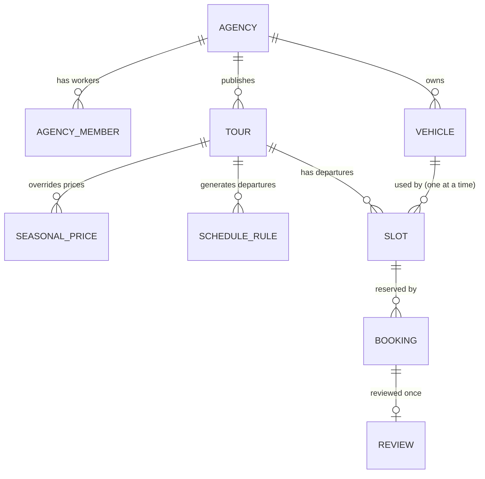

# ADR 0006: Domain model, money and time

- **Status:** Accepted
- **Date:** 2026-11-06

## Model

| Aggregate | Guards |
|---|---|
| **Agency** (tenant) | Membership: at least one manager, no duplicate members. Status: pending approval, active, suspended. |
| **Vehicle** | Capacity 1–500. |
| **Tour** | Pricing that fits its booking mode, seasons that don't overlap, a valid cancellation policy, schedule rules. |
| **Slot** (departure) | **Capacity.** Every reservation goes through `ReserveSeats` / `ReserveWhole`. |
| **Booking** | Its lifecycle (Pending → Confirmed → Completed, or Cancelled / Expired) and its refunds. |
| **Review** | Only for the customer's own completed booking, one per booking, rating 1–5. |

Aggregates reference each other **by ID only**. `BookingService` (a domain service) coordinates Slot and Booking,
and the caller saves both in one transaction.

## Decisions

- **Booking modes.** Each tour is `Shared` (seats), `Private` (the whole departure) or `Both`.
  A private booking reserves the full capacity, so one counter covers both modes.
  Private booking is only possible while no seat is sold.
- **Users.** Every user can book. Agency workers are linked through `AgencyMember (UserId, Role)` with fixed roles
  (Manager, Guide). We don't support tenant-defined roles or permissions.
- **Money.** A `Money` value object (amount + currency) stored as `numeric(12,2)` + `char(3)`. Never floating point.
  Rounding is half away from zero, to cents. Allocation never loses a cent.
  The platform has a single currency (**EUR**). Converted prices are for display only.
- **Snapshots.** A booking copies the unit price, total, cancellation policy and departure times when it's created.
  Later changes to the tour never change existing bookings.
- **Time.** All instants are UTC (`timestamptz`). A tour stores the IANA time zone of its location.
  Schedule rules use local wall-clock time, so a departure stays at 09:00 local across DST:
  a time skipped by spring-forward moves one hour later, and an ambiguous time takes its first occurrence.
  Seasonal pricing uses the departure's local date.
- **Availability.** Departures are generated from schedule rules ahead of time. A unique index on
  `(schedule_rule_id, starts_at)` makes generation idempotent. Departures can also be created, blocked or cancelled by hand.
  Deactivating a rule never touches existing departures.
- **Seat holds.** A new booking is `Pending` and holds its seats for 15 minutes. An expired hold releases the seats.
- **Cancellation.**
  - Customer: refund according to the snapshotted policy (default ≥72h: 100%, ≥24h: 50%, otherwise 0%).
  - Agency or admin: full refund of what was paid.
  - **Partial cancellation:** reducing guests on a shared booking frees those seats and refunds them according to the policy.
- **Deletes.** Tours and vehicles are soft-deleted, with a global query filter. Bookings, payments and reviews are never deleted.
- **Errors.** Expected business failures return `Result` / `Error`, with a stable code and a type that maps to HTTP status.
  Exceptions are reserved for bugs.

## Enforced by the database (defense in depth)

| Rule | How |
|---|---|
| No double-booked vehicle | `EXCLUDE USING gist (vehicle_id WITH =, tstzrange(starts_at, ends_at) WITH &&) WHERE status <> 'Cancelled'` |
| No overlapping seasons | `EXCLUDE USING gist (tour_id WITH =, daterange(valid_from, valid_to, '[]') WITH &&)` |
| No overbooking | `CHECK (reserved_seats BETWEEN 0 AND capacity)` plus **optimistic concurrency** (`xmin` row version): concurrent reservations conflict instead of overbooking |
| Valid values | `CHECK` constraints on capacity, guests, rating, time ranges and date ranges |
| One review per booking | Unique index on `reviews.booking_id` |

## Consequences
- ✅ The core rules hold even if application code has a bug or two requests race each other.
- ⚠️ Exclusion constraints are PostgreSQL-specific (accepted in ADR 0002).
- ⚠️ A concurrency conflict means the API has to retry or return 409. That's handled in the booking flow.
- Deferred ("more time"): discounts, per-tour currency, tenant-defined roles, changing a booking's date.
